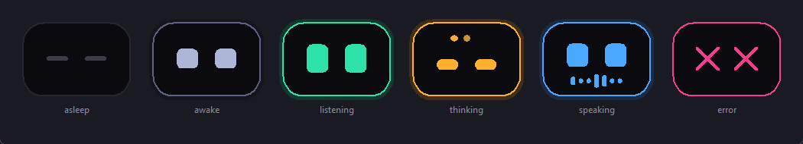
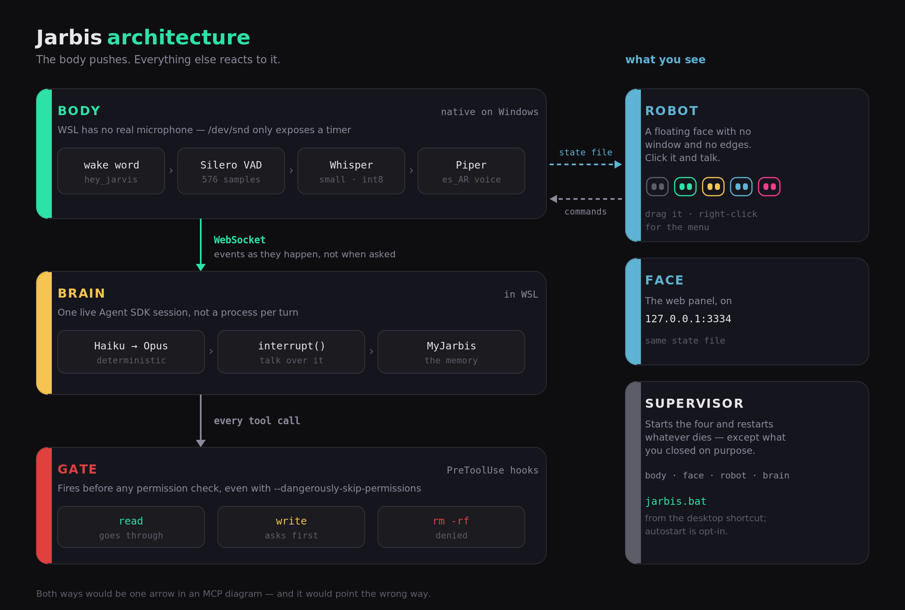

# Jarbis

**Your Claude Code agent, with a body.**

It already thought and remembered:
[MyJarbis](https://github.com/BraianTroncoso/myjarbis) for memory, skills for
style, Claude Code for the thinking. What it had no way of doing was *being
there* — present while you work, reachable without opening a terminal, and able
to start a conversation instead of waiting to be launched.

Jarbis is that missing half. A small face that lives on top of your desktop all
day, with a live session behind it that keeps its memory between turns. It
follows your cursor, blinks, and looks away now and then. You click it and it
listens. It answers out loud — and if you would rather it didn't, you mute it
and it answers in writing instead.



**The voice is a layer, not the product.** It is the fastest way to reach
something that is already on screen, and it is genuinely good: a wake word, a
real VAD, Whisper and a natural-sounding voice, all running locally. But it is
one channel into an agent that thinks, remembers and acts — turn it off and the
agent is still there.

Everything runs on your machine. Nothing leaves it except the Claude API calls
the agent makes on its own.

---

## The one idea that matters

**The body pushes.** That sounds obvious and it is the entire point.

The previous version of this was an MCP server exposing ten tools, and the brain
had to call `submit_voice_prompt` to ask *"did they say anything?"*. MCP is pull:
the model always speaks first. With that shape a proactive assistant is
impossible by construction — not for lack of code, but because of the direction
of the flow.

Here the body opens a WebSocket and emits events as they happen. That enables the
two things that could not exist before: answering without being polled, and
speaking up without being spoken to. Which is also what separates something you
*invoke* from something that is simply **there**.

<p align="center">
  
</p>

The diagram is generated, not drawn: `python3 docs/media/gen.py` rewrites the
SVG and the PNG from one description, so changing a layer is a line of code
instead of an afternoon of nudging boxes.

---

## What it looks like

A frameless, click-through window floating on top of everything. Tk's
`-transparentcolor` on Windows makes a chosen color both invisible *and*
transparent to clicks, so the widget has a real shape instead of being a
rectangle with a drawing inside it.


The menu is drawn on a canvas instead of inherited from the OS, so it matches the
rest: same dark, same rounded corners, same accent.

- **come near it** → it wakes up: eyes open, following your cursor. Waking is
  not listening — the mic stays shut
- **click** → opens the mic; the VAD closes the turn when you stop talking
- **click and hold** → records for as long as you hold it
- **drag** → moves it; the position is remembered
- **right-click** → the menu above
- **double-click** → opens the web panel at `http://127.0.0.1:3334`

The robot reads the same `jarbis-state.json` the web panel does. No second
socket, no startup ordering problem.

### Awake is not listening

Until recently there was asleep and there was listening, with nothing in
between — so the only way to make it look alive was to make it listen, which is
exactly what you don't want from something that sits on your screen all day.

**Awake** is the state that was missing. Eyes open, mic shut. It follows your
cursor, blinks at irregular intervals (a regular blink reads as a metronome),
glances away every half-minute or so, and breathes on a six-second cycle. After
30 seconds without you it closes its eyes again.

The Clippy lesson, stated properly: what made the Office assistant charming was
that it had a life of its own when nothing was happening. What made it hated was
that it *interrupted*. This is the first half and none of the second — the robot
never starts a conversation. That is still the reflex's job, and the reflex has
no sensors on purpose.

Two things worth knowing about how it is built:

- **Awake lives in the robot, not in the body.** Waking is a way of being drawn,
  not a way of being put to work. No new state in the body's state machine, no
  new field in the state file, no lie to keep in sync.
- **Sleeping now costs less than it used to.** The widget animated at 20 fps
  with its eyes closed; asleep it drops to 4.

On a light desktop:


---

## Requirements

- **Windows 10/11** for the body. The transparent widget, the global hotkey and
  PortAudio all depend on it.
- **WSL2** for the brain, or any machine that can reach the bridge. The brain is
  just a WebSocket client; it does not have to live in WSL.
- **Python 3.10+** on the WSL side, **3.11+** on the Windows side.
- **Claude Code**, installed and authenticated, for the brain to think with.
- No GPU. Everything here was measured on an i7-1255U with no CUDA.

## Install

```bash
git clone https://github.com/BraianTroncoso/jarbis
cd jarbis

bash scripts/fetch-models.sh     # 239 MB, licenses listed below
pip install claude-agent-sdk     # the brain

# Copy the body to the Windows side. Point it at a Python environment that has
# sounddevice, faster-whisper and onnxruntime installed.
JARBIS_VENV=/mnt/c/Users/you/some-venv bash scripts/deploy-body.sh
```

`deploy-body.sh` finds your Windows profile under `/mnt/c/Users`, writes the
package there, generates the launchers and leaves a shortcut on your desktop.
Override anything with `JARBIS_WIN_USER`, `JARBIS_DEST` or `JARBIS_VENV`.

The body has to run natively on Windows: WSL has no real microphone (`/dev/snd`
only exposes `timer`) and PortAudio does not survive the WSLg PulseAudio bridge.

## Run

```
C:\Users\you\jarbis-body\doctor.bat --deep    # diagnose first
C:\Users\you\jarbis-body\jarbis.bat           # body · face · robot · brain
```

`jarbis.bat` is the supervisor: it starts the four components, restarts whatever
dies with exponential backoff, and launches the brain inside WSL via `wsl.exe`.

**Click the robot and talk to it.** Hold to talk longer.

### On demand, or always on

Deploying puts a **Jarbis** shortcut on your desktop and, by default, touches
nothing else. Autostart is a choice you make, not something that happens to you:

```bash
JARBIS_AUTOSTART=1 bash scripts/deploy-body.sh   # also starts with Windows
JARBIS_AUTOSTART=0 bash scripts/deploy-body.sh   # take it out of Startup
JARBIS_DESKTOP=0   bash scripts/deploy-body.sh   # no desktop shortcut either
```

With neither set, whatever is already in your Startup folder stays as it is. You
can change your mind later without redeploying — `shortcuts.ps1` ships next to
the launchers and takes `-Autostart` / `-NoAutostart`.

### Closing it closes it

**Cerrar Jarbis** in the right-click menu shuts the whole thing down — the
robot, the panel, the body with Whisper loaded in memory, and the brain session.
It does not come back on its own. The desktop shortcut is how you call it back.

That sounds obvious and it was not: a supervisor that restarts everything that
dies restarts the thing you just closed, because from the outside *closing looks
exactly like crashing*. The robot now exits with a reserved code when you are the
one closing it, and that is the only difference the supervisor needs.

### A note on WSL networking

With `networkingMode=NAT` the WSL VM has its own loopback, so `127.0.0.1` on the
Windows side is unreachable from WSL — localhost forwarding only goes
Windows → WSL. The bridge binds to loopback **plus** the `vEthernet (WSL)`
adapter address, which from inside WSL is the default gateway. It deliberately
never binds `0.0.0.0`: that would publish the bridge on whatever Wi-Fi you are
on. `bridge/netif.py` does that filtering and explains itself.

---

## Why some pieces are deliberately not models

**What decides *when* to speak is not an LLM, on purpose.** There is published
evidence that a small deterministic controller beats every LLM-based trigger
architecture at exactly this task, and that frontier models asked "should I
interrupt?" answer yes almost every time. `reflex.py` is a set of filters:
cooldown, time window, don't talk over the user, don't repeat yourself.

**The local model is a reflex, not a cortex.** On DDR4-3200 dual channel the
effective memory bandwidth is around 27 GB/s, which caps a dense 8B model at
4-5 tokens per second. That ceiling is bandwidth, not tuning, so thinking goes to
the API and only the fast paths stay local.

**The STT engine was chosen by measuring, and the answer was "don't change it".**
`compare_stt.py` runs Whisper, Moonshine and NeMo Canary against the same
synthesized phrases. Canary was 7.3× faster and 18 WER points worse. Whisper
stayed.

---

## Layout

```
body/jarbis_body/
  audio/        wake word, Silero VAD, STT, TTS, presence, hotkey, resampling
  robot/        shape (geometry) · render (drawing) · widget (window) · menu ·
                idle (the life it has when nothing is happening)
  state/        state machine, and the writer the robot and the panel read
  bridge/       protocol, push server, command client, network binding
  orchestrator.py   wires it together
  reflex.py     decides WHEN to speak first (no LLM)
  greeting.py   the morning greeting, the only trigger that is wired up
  supervisor.py starts the four pieces and replaces them
  doctor.py · face.py
brain/
  client.py     transport: bridge ↔ engine
  engine.py     Agent SDK (live session) · subprocess (fallback) · escalation
hooks/          gate.py (decides) · audit.py (logs) · settings.json
assets/         jarbis.ico, generated from the same geometry as the face
web/index.html  the panel
scripts/        fetch-models · deploy-body · bench_voice · bench_brain ·
                tune_stt · compare_stt · diag_wakeword · preview_robot ·
                make_icon
tests/          253 tests, none of them need a microphone
```

### The audio layer is inherited

`voicemode.py`, `wakeword.py`, `tts.py`, `presence.py` and `hotkey.py` come from
[**GesturePilot**](https://github.com/BraianTroncoso/GesturePilot) v0.2.0
(MIT, January 2026) almost verbatim — about 2,400 lines
that already worked. The comments still say so, file by file. What was rewritten
is the end of the pipeline (pull to push), the state machine (its timeouts never
fired), and the gate (it did not exist).

---

## The gate

Every tool call the brain makes passes through a `PreToolUse` hook before
anything runs. Reads go through, writes ask, destructive commands are denied.

Two details that are easy to get wrong:

- `PreToolUse` hooks fire **before** any permission-mode check, including under
  `--dangerously-skip-permissions`. That is what makes this a real boundary and
  not a suggestion.
- The denying hook has to be **first** in the array. Ordering is not cosmetic.

It has been tested against a real `rm -rf`.

---

## Tests

```bash
python3 -m pytest tests/ -q          # 253 tests, no microphone needed
```

The calibration benches do need the Windows environment:

```
diag.bat bench_voice.py      # the whole chain, end to end
diag.bat compare_stt.py      # engine vs. latency vs. accuracy
diag.bat diag_wakeword.py    # wake word threshold
diag.bat preview_robot.py    # the five states, as a PNG
```

They use Piper as a *fake mouth*: synthesize phrases, run them through the chain,
compare against the original text. That closes the loop with nobody talking.

---

## Known limits

- **It is barely proactive yet.** Speaking first is wired end to end — the push
  bridge, the filters that decide when it would be rude, the tests — but only
  one trigger is plugged into it, the morning greeting, and that ships disabled.
  The reflex has no sensors. The capability is real; the uses of it are not
  written.
- **Voice is the only way in.** Muting turns off the *answer* out loud, not the
  question: the way you reach it is still to click and talk. Typing to it from
  the panel is the obvious next thing and is not built.
- **The wake word is English-only.** The bundled `hey_jarvis.onnx` scores
  0.77-0.95 on English speech and 0.157 on Spanish against a 0.50 threshold, so
  it ships off. Training a Spanish one needs CUDA; the path is documented, the
  work is not done.
- **~8.5 seconds** from when you stop talking to when it answers. Roughly half of
  that is Whisper.
- **The UI and the voice are in Spanish.** The Piper voice, the Whisper language
  and the menu labels are configured for Spanish. All three are settings, not
  assumptions baked into the code.

---

## Memory lives somewhere else

There are deliberately no loose `.md` files. Everything about this project —
decisions, hardware traps, measurements, open threads — lives in a project-local
[MyJarbis](https://github.com/BraianTroncoso/myjarbis) database
(`.myjarbis/memory.db`, SQLite + FTS5), split into four modules: `cuerpo`,
`cara`, `cerebro`, `operacion`.

    myjarbis status                 # where things stand
    myjarbis module use cuerpo      # open a module
    claude  →  /jarbis              # and work with context loaded

MyJarbis is **optional**. Jarbis runs without it; the brain just has less memory
to work with. This README is the front door; the reasoning is in the database.

---

## Licenses

The code is **MIT** — see [LICENSE](LICENSE). The models are not all the same:

| model | license |
|---|---|
| `hey_jarvis.onnx` (livekit-wakeword) | Apache-2.0, code **and** weights |
| `silero_vad.onnx` | MIT |
| `es_AR-daniela-high` | CC BY-SA 4.0 (OpenSLR 61) |
| `es_ES-davefx-medium` | CC0 |
| faster-whisper / CTranslate2 | MIT |
| Piper (`piper1-gpl`) | **GPL-3.0-or-later** |

Watch that last row. Piper moved from `rhasspy/piper` (MIT, archived) to
`OHF-Voice/piper1-gpl` (GPL-3.0). Jarbis invokes Piper as a separate process and
does not link against it, which is why MIT holds here — but if you redistribute a
bundle that ships Piper inside it, that distinction matters.
